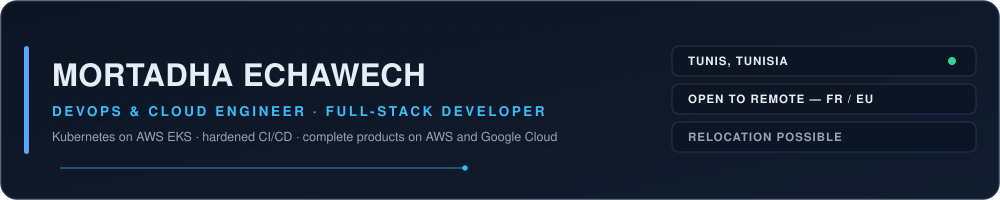
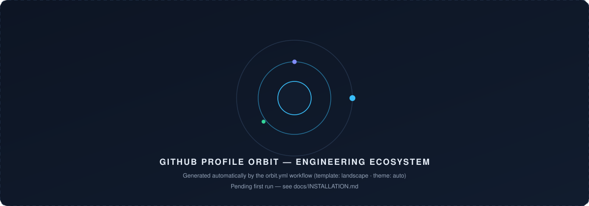
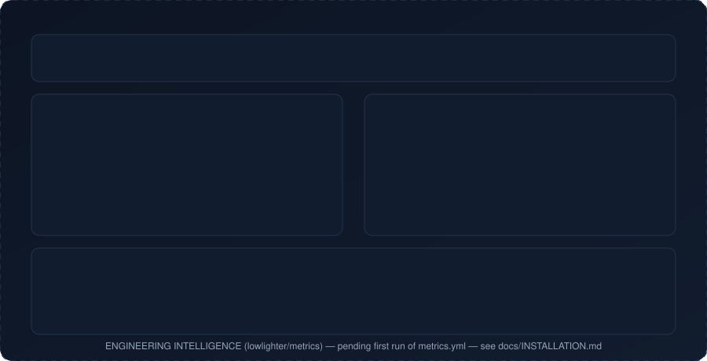
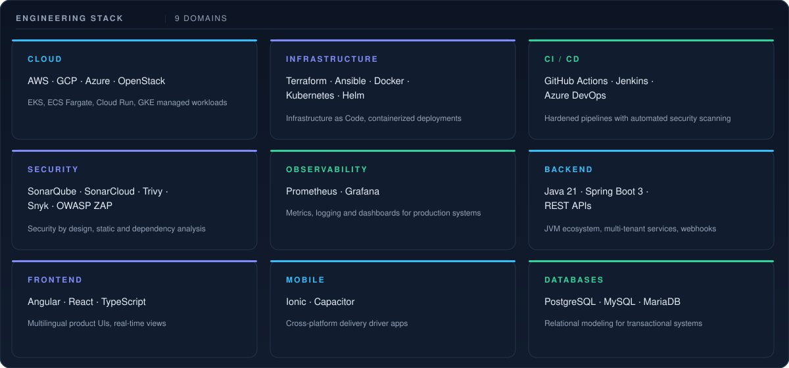
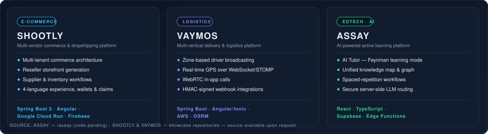

<!-- ═══════════════════════════════════════════════════════════════════════════
     ENGINEERING COMMAND CENTER — github.com/mortadhaechawech
     Sections: A Identity · B Orbit ecosystem · C Metrics intelligence
               D Stack matrix · E Featured systems · F Principles
               G Current focus · H Footer
     Palette: #080D18 · #0D1524 · #111C2E · #23334B · #38BDF8 · #818CF8
              #E5EDF7 · #94A3B8 · #34D399
     ═════════════════════════════════════════════════════════════════════ -->

<!-- ═════════════ A. IDENTITY HEADER ═════════════ -->

 

> Production experience running **Kubernetes on AWS EKS**, building **CI/CD pipelines hardened with automated security scanning**, and shipping complete products end to end on **AWS and Google Cloud**. Strong JVM engineering (Java 21, Spring Boot 3) with a React/TypeScript frontend practice.

 

<!-- ═════════════ B. ENGINEERING ECOSYSTEM ═════════════ -->

## &nbsp;B · ENGINEERING ECOSYSTEM

<!-- Generated automatically by .github/workflows/orbit.yml (NiconiKimg/github-profile-orbit).
     This placeholder is replaced on the first workflow run. -->

 

<!-- ═════════════ C. ENGINEERING INTELLIGENCE ═════════════ -->

## &nbsp;C · ENGINEERING INTELLIGENCE

<!-- Generated automatically by .github/workflows/metrics.yml (lowlighter/metrics).
     This placeholder is replaced on the first workflow run. -->

 

<!-- ═════════════ D. ENGINEERING STACK ═════════════ -->
## &nbsp;D · ENGINEERING STACK

 

<!-- ═════════════ E. FEATURED ENGINEERING SYSTEMS ═════════════ -->

## &nbsp;E · FEATURED ENGINEERING SYSTEMS

### ▪ SHOOTLY — Multi-vendor commerce & dropshipping platform

A commerce ecosystem connecting suppliers, resellers, and customers through branded
storefronts, seller wallets, payouts, and claims management.

- **Architecture** — multi-tenant commerce core, reseller storefront generation
- **Workflows** — supplier onboarding, inventory, wallet payouts, claims
- **I18N** — four-language customer experience
- **Stack** · `Spring Boot 3` `Angular` `Google Cloud Run` `Firebase`

### ▪ VAYMOS — Multi-vertical delivery & logistics platform

A real-time delivery platform with automated dispatching, driver coordination,
and location-aware operations.

- **Dispatch** — zone-based driver broadcasting engine
- **Real-time** — GPS tracking over WebSocket/STOMP, WebRTC in-app calls
- **Integrations** — HMAC-signed webhooks, OSRM routing
- **Stack** · `Spring Boot` `Angular/Ionic` `AWS` `OSRM`

### ▪ ASSAY — AI-powered active learning platform → [`/assay`](https://github.com/mortadhaechawech/assay)

An intelligent learning environment combining personalized tutoring, knowledge
mapping, and spaced repetition.

- **AI Tutor** — Feynman teaching mode, personalized progression
- **Knowledge** — unified knowledge map linking paths, quizzes & reviews
- **Memory** — spaced-repetition workflows
- **Security** — server-side LLM routing, no client-exposed keys
- **Stack** · `React` `TypeScript` `Supabase` `Edge Functions`

Repository note — the ASSAY repository is real but currently empty (code publication pending).
SHOOTLY and VAYMOS source repositories are private deployments; no public link is invented here.

 

<!-- ═════════════ F. ENGINEERING PRINCIPLES ═════════════ -->

## &nbsp;F · ENGINEERING PRINCIPLES

**`IaC`** Infrastructure as Code — every environment declarative, reproducible, reviewable
**`AUTO`** Automation First — pipelines over clicking, scripts over tribal knowledge
**`SEC`** Security by Design — scanning and hardening inside CI/CD, not after it
**`OBS`** Observability — instrumentation shipped with the feature, not bolted on
**`REL`** Production Reliability — boring, consistent rollouts that survive traffic

 

<!-- ═════════════ G. CURRENT ENGINEERING FOCUS ═════════════ -->
## &nbsp;G · CURRENT ENGINEERING FOCUS

- **Advanced AWS architecture** — EKS, ECS Fargate, networking, cost-aware design
- **Kubernetes platform engineering** — Helm charting, workload reliability
- **Terraform** — IaC modules for deployable, reviewable infrastructure
- **Secure CI/CD** — GitHub Actions pipelines with automated security scanning
- **DevSecOps** — shift-left security across build and deploy
- **Cloud observability** — Prometheus + Grafana production dashboards

 

<!-- ═════════════ H. FOOTER ═════════════ -->
---

<h3 align="center">
  <a href="#featured-engineering-systems">BUILD</a> ·
  <a href="#engineering-ecosystem">AUTOMATE</a> ·
  <a href="#engineering-principles">SECURE</a> ·
  <a href="#engineering-intelligence">OBSERVE</a>
</h3>

  <a href="https://mortadhaechawech.netlify.app">Portfolio</a> ·
  <a href="https://linkedin.com/in/mortadha-echawech-5312b7221">LinkedIn</a> ·
  <a href="mailto:mortadhaechawech@outlook.com">Email</a>

